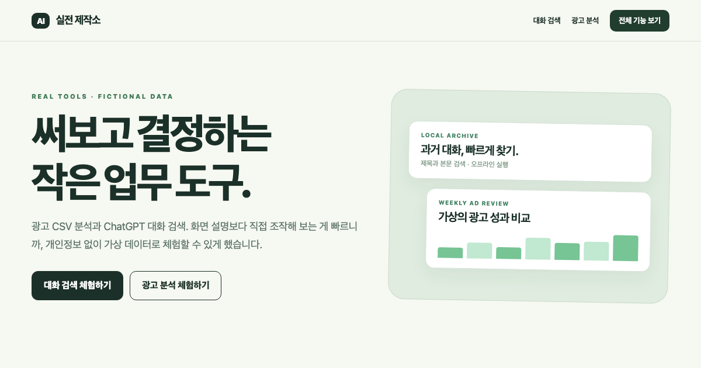

# AI 실전 제작소 | Free interactive demos

**Offline tools for people who want to try the workflow before buying.** This repository contains only a fictional-data marketing preview, not the separately sold software. No customer datasets, login credentials, ad account data, or conversation exports are included.

[**Try the free demo (no login)**](https://latpeed-ai-lab-preview.pages.dev/) · [**Check your own file format privately**](https://latpeed-ai-lab-preview.pages.dev/check/) · [AdPilot Lite](https://www.latpeed.com/products/sb5ge) · [Archive Lens](https://www.latpeed.com/products/tej54)

## What can you try?

| Preview | Free interactions | Full version (sold separately) |
| --- | --- | --- |
| **Archive Lens 1.1** | Search 3 fictional ChatGPT-style conversations; select and read one | Open conversations.json locally, search messages, filter by time, export search results to CSV or chats to Markdown |
| **AdPilot Lite 1.1** | Switch between fictional A/B campaigns to compare seven-day ad spend, installs and CPI | Import Meta/Moloco CSV, map fields, analyze campaigns, save reports |

## 무료 체험과 유료판의 차이

- 무료 체험 페이지는 **가상 데이터만 제공**하며 실제 CSV·JSON 업로드가 불가능합니다.
- 판매용 프로그램은 래피드에서 구매하는 별도의 오프라인 도구입니다.
- Archive Lens는 AI 의미 검색이 아닌 텍스트 검색입니다.
- AdPilot은 규칙 기반 지표 점검 도구이며 광고 계정 연결, 자동 예산 변경 또는 성과 보장을 제공하지 않습니다.
- 모든 개인 대화 및 광고 데이터는 구매자가 직접 관리해야 합니다.

## Privacy and affiliation

- The preview has no file upload form, signup form or third-party analytics script.
- The site host (Cloudflare) may process ordinary access logs.
- The products are independent and not affiliated with OpenAI, ChatGPT, Meta or Moloco.
- This repository demonstrates neither paid program's full behavior.

## Local usage

Open index.html in your browser. No installation, account or API key is required.

## Scope and licensing

Only the public fictional-data demo is included here. Paid archives, private automation and original production source are **not** included. This repository does not grant a license to redistribute or resell the paid software. For questions, contact the seller through the product page.

## Feedback

Please file a GitHub issue with browser/version and reproducible steps when the *free preview* fails. Do not post actual ChatGPT conversations, ad CSVs, passwords or account identifiers.

## Free local file pre-check

Visit [ChatGPT JSON / ad CSV format pre-check](https://latpeed-ai-lab-preview.pages.dev/check/). You may select your own JSON or CSV from disk without signing in.

- JSON: if file is 20MB or smaller, count conversation-like entries, detect mapping and messages fields; larger files are checked for partial header indicators only.
- CSV/TSV: inspect the header only and suggest likely date, spend, campaign, ad ID, impressions, clicks, install and currency fields.
- Local File API; no file data is sent over the network, no ad pixels and no analytics SDK.
- The result is a preliminary structural check, **not a promise the paid application will import the file**.
- The free source and all restrictions are transparent in check/check.js.
\n## Support\nBuyer questions: https://latpeed-ai-lab-preview.pages.dev/contact/. Do not send sensitive JSON or ads data in email.\n

## Attribution, not user tracking

The public demo carries an **allowlisted channel name only** through the free
pre-check and to Latpeed product links when arriving from a listed directory.
Implementation: attribution.js. No cookies, localStorage, network beacons,
fingerprinting, source file contents, or account IDs. Channels without a known
UTM/referrer keep the original product URLs. Whether Latpeed reports campaign
parameters in seller analytics is not guaranteed. UTM parameters alone do not
measure visitors, conversions, or purchases.
